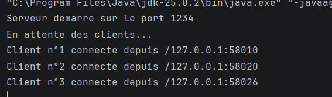
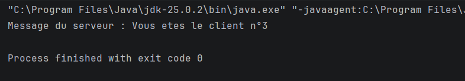
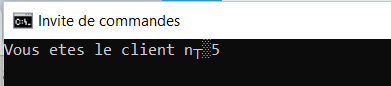
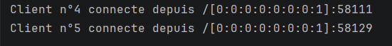
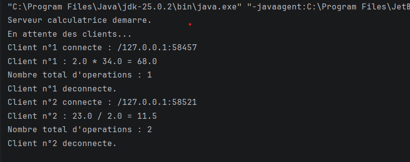
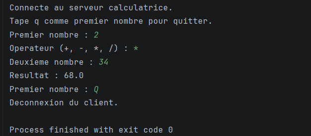
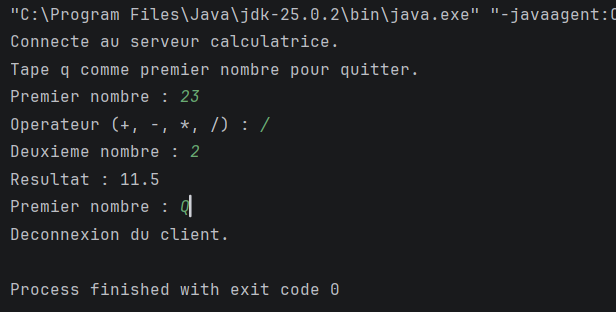

# TP3-DAR2026 — Programmation réseau en Java

## Présentation du TP

Ce TP a pour objectif de mettre en pratique la programmation réseau en Java à l'aide des sockets TCP et des threads.

Il est composé de deux parties :

- **Partie 1 :** permettre au serveur d'accepter plusieurs clients et de gérer leurs connexions.
- **Partie 2 :** améliorer une calculatrice client-serveur afin de traiter des opérations envoyées par plusieurs clients simultanément.

---

# Partie 1 — Gestion de plusieurs clients

## 1. Objectif

L'objectif de cette première partie est de modifier un serveur TCP afin qu'il puisse accepter plusieurs connexions clientes au lieu de traiter un seul client.

Le serveur doit pouvoir identifier les clients connectés et afficher leurs adresses réseau. Chaque client est pris en charge par un thread afin que plusieurs clients puissent être gérés sans bloquer le serveur.

## 2. Fonctionnement

Le serveur utilise une boucle pour attendre les connexions entrantes. Lorsqu'un client se connecte :

1. Le serveur accepte la connexion avec `accept()`.
2. Il récupère les informations du client connecté.
3. Il attribue un numéro au client.
4. Il crée un thread pour gérer ce client.
5. Il continue à attendre d'autres connexions.

Cette organisation permet au serveur de continuer à accepter de nouveaux clients pendant que les connexions précédentes sont prises en charge.

## 3. Test du serveur et du client

Le serveur est lancé en premier. Le client se connecte ensuite au serveur à l'aide d'une socket TCP.

Les consoles permettent de vérifier le démarrage du serveur, la connexion du client et les informations affichées lors de la communication.

### Capture 1 — Console du serveur

Cette capture montre le serveur en cours d'exécution et les informations relatives aux connexions reçues.

### Capture 2 — Console du client

Cette capture présente le client après son lancement et sa connexion au serveur.

## 4. Test avec Telnet

Telnet est utilisé pour vérifier qu'il est possible d'établir une connexion TCP avec le serveur.

Ce test permet notamment d'observer l'ouverture d'une connexion depuis un terminal, sans utiliser le programme Java Client.

### Capture 3 — Connexion avec Telnet

---

# Partie 2 — Calculatrice client-serveur multithreadée

## 1. Objectif

La deuxième partie consiste à améliorer l'application client-serveur développée précédemment en ajoutant une calculatrice capable de traiter les opérations envoyées par les clients.

Le serveur reçoit les opérations sous forme d'objets Java, effectue les calculs et renvoie les résultats aux clients.

L'utilisation des threads permet de traiter plusieurs clients simultanément.

## 2. Échange des données

La communication entre le client et le serveur repose sur des objets Java sérialisables.

La classe `Operation` représente une opération mathématique. Elle contient les informations nécessaires au calcul, notamment les deux opérandes et l'opérateur, ainsi que les données permettant de transmettre le résultat ou une erreur.

Le déroulement d'une opération est le suivant :

1. Le client saisit les nombres et l'opérateur.
2. Le client crée un objet `Operation`.
3. Il envoie cet objet au serveur.
4. Le serveur reçoit l'objet et effectue le calcul.
5. Le serveur renvoie l'objet contenant le résultat ou le message d'erreur.
6. Le client affiche la réponse reçue.

Les opérations prises en charge sont l'addition, la soustraction, la multiplication et la division.

## 3. Gestion des opérations

Le serveur traite chaque client dans un thread indépendant. Ainsi, la connexion d'un client n'empêche pas les autres clients de se connecter et d'effectuer leurs propres calculs.

Un compteur partagé permet de suivre le nombre total d'opérations réussies traitées par le serveur. La synchronisation protège la mise à jour de ce compteur lorsque plusieurs threads effectuent des calculs en parallèle.

## 4. Test du serveur de calculatrice

Le serveur est lancé avant les clients. Il attend leurs connexions, reçoit les opérations envoyées et transmet les résultats correspondants.

### Capture 4 — Console du serveur

Cette capture montre le serveur de calculatrice en fonctionnement et les informations affichées lors du traitement des opérations.

## 5. Test de plusieurs clients simultanément

Plusieurs instances du client sont lancées pendant que le serveur reste actif. Chaque client peut saisir et envoyer ses propres opérations.

Ce test permet de vérifier que le serveur accepte plusieurs connexions et que les clients peuvent effectuer des calculs sans devoir attendre la fermeture des autres connexions.

### Capture 5 — Plusieurs clients simultanés
Premier client

deuxieme client

---

# Conclusion

Ce TP a permis de mettre en pratique les communications réseau en Java avec les sockets TCP et la gestion des connexions multiples à l'aide des threads.

La première partie a permis d'étudier l'acceptation de plusieurs clients et de tester les connexions avec un client Java et Telnet.

La deuxième partie a permis d'ajouter une calculatrice client-serveur utilisant des objets sérialisables, de gérer plusieurs clients simultanément et de protéger un compteur partagé grâce à la synchronisation.

Ces deux parties illustrent l'importance des sockets, des threads et de la synchronisation dans le développement d'applications réseau en Java.
